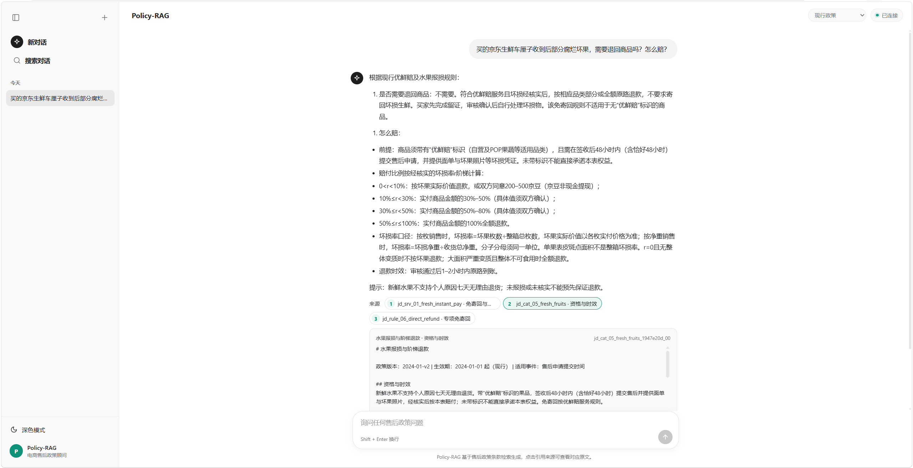
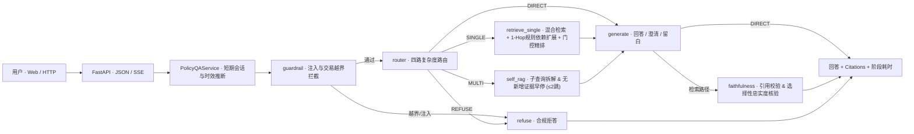

<h1 align="center">Policy-RAG · 电商售后政策问答系统</h1>

<p align="center"><strong>面向电商退换货、运费核算与保修咨询场景的检索增强问答系统，重点解决品类特例与通用总则混淆、过期历史规则误引以及跨文档隐式条件漏检问题。</strong></p>

<p align="center">
  FastAPI × LangGraph × Qdrant × BGE + Cross-Encoder (PyTorch / ONNX INT8) × NetworkX 规则依赖图
</p>

<p align="center">
  <a href="https://github.com/yingjun-huang/policy-RAG/actions/workflows/ci.yml"></a>
  <a href="LICENSE"></a>
  
  
</p>

---

## 界面快照

<p align="center">
  
</p>

<p align="center"><sub>Web 对话台：面对“手机收到好几天了，现在还能退吗？”等前提缺失问题，系统先关联手机激活细则与通用退货总则主动反问澄清，待用户补充条件后给出明确结论并附可核对原文的条款来源</sub></p>

---

## 解决什么问题

普通知识库问答一旦放进真实电商售后规则里，常见错答往往集中在四件事上：

| 维度 | 常见简单 RAG 的做法 | 本项目的处理 | 代码入口 |
| :--- | :--- | :--- | :--- |
| **切块与表格** | 固定长度滑窗切块，常把前置免责条件与折旧表切碎 | 标题层级父子分块，超长表格按行切分并自动复写表头 | [`chunking.py`](policy_rag/indexing/chunking.py) |
| **版本与时效** | 现行规则与已归档旧规混在同一向量池里召回 | 提取生效区间与类目写入 Qdrant 标量索引，默认隔离旧版，对比问题自动解锁 | [`vector.py`](policy_rag/retrieval/vector.py) · [`filters.py`](policy_rag/retrieval/filters.py) |
| **隐式关联条款** | 仅靠词面 + 向量召回，只问“衣服能退吗”易漏上位总则 | 基于 `config/policy_graph.yaml` + NetworkX 做 1-Hop 规则依赖扩展，再经 Cross-Encoder 门控精排 | [`clause_graph.py`](policy_rag/retrieval/clause_graph.py) · [`reranker.py`](policy_rag/retrieval/reranker.py) |
| **路由与后置核验** | 所有问题跑同一条链，条件不足也直接强答 | 四路复杂度路由 + 检索后三态决策（回答 / 追问澄清 / 留白）+ 引用校验与选择性忠实度核验 | [`graph.py`](policy_rag/agents/graph.py) · [`nodes.py`](policy_rag/agents/nodes.py) |

---

## 系统架构



一次检索提问会先经过安全护栏与复杂度分流，简单问候跳过检索，单跳与多跳问题走 `BM25 + BGE + Qdrant 标量过滤 -> RRF -> NetworkX 1-Hop 扩展 -> Cross-Encoder 门控精排`，随后按法条效力优先级（`专项服务/版本 > 品类特例 > 通用总则`）与首尾重排组装上下文；生成后经 `chunk_id` 引用校验与忠实度自纠错，再通过 SSE 流式下发。

---

## 快速开始

### 1. 安装环境

需要 **Python 3.11+**。基础依赖与本地向量/精排推理包分开声明：

```bash
git clone https://github.com/yingjun-huang/policy-RAG.git
cd policy-RAG
pip install -e ".[ml,dev]"
cp .env.example .env
```

在 `.env` 中填入兼容 OpenAI 接口的模型密钥（默认对接 DeepSeek）：

```env
KNOWLEDGE_DIR=knowledge_jd
LLM_API_KEY=your_deepseek_api_key
LLM_BASE_URL=https://api.deepseek.com
LLM_MODEL=deepseek-chat
LOCAL_EMBEDDING_ENABLED=true
CROSS_ENCODER_ENABLED=true
```

> `.env` 为空时仍可运行离线测试与本地检索；未显式配置外部 `QDRANT_URL` 时，Qdrant 以嵌入式模式本地运行，无需额外启动容器。

### 2. 启动服务与 Web 界面

```bash
uvicorn policy_rag.api.main:app --host 127.0.0.1 --port 8000
```

打开 **`http://127.0.0.1:8000`** 即可直接使用对话界面；交互式接口文档位于 `/docs`，运行状态自检位于 `/api/v1/capabilities`。

### 3. 接口调用示例

```bash
curl -s http://127.0.0.1:8000/api/v1/capabilities
curl -s http://127.0.0.1:8000/api/v1/chat \
  -H "content-type: application/json" \
  -d '{"message":"已激活的手机还能七天无理由退货吗？","session_id":"demo_01"}'
```

流式接口为 `POST /api/v1/chat/stream`，通过 SSE 先推送 `status` 与节点进度 `node_update`，待生成与后置核验完成后再分段发送最终答案 `token` 与完整结果 `done`。

---

## 实测结果

语料库 [`knowledge_jd/`](knowledge_jd) 共 **32 篇**售后政策文档（114 个切片，含 2 篇归档历史版本），测试集包含 **145 条基准题（176 轮对话）** 与 **35 条护栏专项题**。默认采用 `BAAI/bge-small-zh-v1.5`、Cross-Encoder（`BAAI/bge-reranker-base`，支持按需切换 ONNX INT8）与 `deepseek-chat`。

### 1. 七路检索与版本隔离消融（FP32 基线评测口径）

| 检索方案 | P@1 | R@5 | Complete@5 | 复杂问题 Complete@5 | MRR | 版本匹配准确率 |
| :--- | :---: | :---: | :---: | :---: | :---: | :---: |
| 1. BM25（无版本过滤） | 74.48% | 88.28% | 79.31% | 73.83% | 0.8427 | 80.00% |
| 2. Vector（无版本过滤） | 82.76% | 94.71% | 88.97% | 85.05% | 0.9069 | 76.55% |
| 3. Hybrid RRF（无版本过滤） | 90.34% | 95.17% | 90.34% | 87.85% | 0.9483 | 77.93% |
| 4. Hybrid + 元数据过滤与生效期校验 | 90.34% | 95.17% | 90.34% | 87.85% | 0.9483 | **100.0%** |
| 5. Hybrid + 过滤 + Rerank (FP32) | **93.10%** | 96.55% | 92.41% | 89.72% | **0.9603** | **100.0%** |
| 6. Hybrid + 规则依赖图 (1-Hop, v1) + Rerank | **93.10%** | 97.70% | 95.17% | 93.46% | 0.9591 | **100.0%** |
| 6b. Hybrid + 规则依赖图 (YAML, CE相关性门控) + Rerank | **93.10%** | **98.05%** | **95.86%** | **94.39%** | **0.9603** | **100.0%** |

> 注：`3. Hybrid RRF（无版本过滤）` 的旧版隔离率为 `73.33%`（归档规则误召回率 `26.7%`），加入过滤与生效期校验后误召回率降至 `0%`；`Complete@5` 统计逻辑文档级 Top-5 证据覆盖。

### 2. 在线问答、护栏与选择性核验（`deepseek-chat`）

- **端到端问答质量**（FP32 基线，176 轮，三档裁判）：加权分 **95.17%**（`correct=1 / partial=0.5 / incorrect=0`），严格完全正确率 **92.61%**（`163/176`）。
- **多轮澄清与护栏**：反问澄清 P/R 为 **96.0% / 77.42%**；越界办理请求拒答 **100.0%**（`11/11`），正常基准集误拒答 `0` 例，条款级引用锚点存在性校验通过率 **100.0%**。
- **选择性忠实度核验**：通过 `faithfulness_risk_gate_enabled` 仅对含数值/部分时效表达或证据状态非 `SUFFICIENT` 的轮次触发 Faithfulness 核验，跳过低风险定性与澄清轮次以减少延迟与误纠风险。

### 3. 独立工程对比实验（量化加速与 Embedding 选型）

- **Cross-Encoder ONNX INT8 动态量化**（独立 8 候选 CPU 重排基准，不含图扩展开销）：重排阶段 P95 延迟由 PyTorch FP32 的 **702.28ms** 降至 **294.02ms**，检索 `P@1` 由 `93.10%` 降至 `91.72%`（`-1.38 pp`）；系统支持在 `.env` 中通过 `CROSS_ENCODER_USE_ONNX=true` 启用量化后端。
- **Embedding 模型对比**（145 题，ONNX INT8 重排）：过滤后纯向量检索阶段 `BAAI/bge-m3`（ONNX）精度更高（`P@1 93.79%`、`Complete@5 95.86%` vs `bge-small-zh-v1.5` 的 `86.21%` / `88.97%`）；但在当前固定的 BM25 + 规则依赖图 + Cross-Encoder 重排全链路上，`bge-small-zh-v1.5` 取得了同等甚至略高的文档级覆盖（`Complete@5 95.17%` vs `94.48%`），同时全链路检索 CPU P50 耗时仅为 **362.59ms**（`bge-m3` ONNX 为 **848.18ms**），适合作为默认轻量双塔配置。

### 本地复现命令

```bash
# 单元测试与 API 契约测试（离线快速，不消耗 API 额度）
python -m pytest -q

# 7 路检索消融 + 离线行为验证
python -m eval.runner --mode all

# 在线 DeepSeek 全量评测（带 SQLite 响应缓存与并发控制）
python -m eval.runner --mode all --live-llm --concurrency 6

# Cross-Encoder 相关性门控与独立 8 候选 CPU 重排量化基准
python -m scripts.tune_reranker_and_gate

# Embedding 模型对照 / SSE 延迟基准 / 跨模型裁判一致性检查
python -m scripts.benchmark_embeddings --offline-only --models BAAI/bge-small-zh-v1.5 BAAI/bge-m3
python -m scripts.benchmark_e2e_sse
python -m scripts.cross_model_judge --model deepseek-reasoner --concurrency 8
```

---

## 目录结构

```text
policy-RAG/
├── config/policy_graph.yaml      # 配置化规则依赖图规则（继承总则 / 争议举证 / 互补服务）
├── docs/assets/                  # 文档与界面演示截图
├── eval/                         # 评测集、三档裁判、消融脚本与指标计算
├── knowledge_jd/                 # 32 篇电商售后政策语料（含现行与归档历史版本）
├── policy_rag/
│   ├── agents/                   # LangGraph 状态机、四路路由与受控补检循环
│   ├── api/                      # FastAPI 路由（/chat, /chat/stream, /capabilities）
│   ├── guardrails/               # 指令注入检测与交易办理类越界拦截
│   ├── indexing/                 # Markdown 父子分块、表格保护与文本清洗
│   ├── providers/                # DeepSeek 客户端、SQLite 缓存、BGE 与 ONNX Cross-Encoder
│   ├── retrieval/                # Qdrant 标量过滤、BM25、RRF、ClauseGraph 与门控精排
│   ├── schemas/                  # Pydantic 请求/响应与追溯 Schema
│   ├── web/index.html            # 单页对话与引用查看界面
│   ├── config.py                 # 配置中心
│   └── service.py                # 依赖容器、能力探测与会话编排
├── scripts/                      # 候选边挖掘、量化、SSE/Embedding 压测与跨模型裁判脚本
└── tests/                        # 单元测试与端到端测试（62 passed）
```

---

## 使用边界与设计取舍

本项目定位为**纯售后政策知识问答系统**，以下边界属于刻意取舍，而非遗漏：

- **短期内存会话而非持久化数据库**：服务端通过 `sessions[session_id]` 维护最近 12 条多轮上下文（配合 Web 端 `localStorage`）以支持条件追问与意图纠偏；未引入 Redis / PostgreSQL 做跨重启用户历史与长程记忆压缩。
- **不挂载业务写操作工具**：系统拦截“直接退款/改订单状态”等交易指令而非执行写库操作，保证政策问答边界清晰。
- **嵌入式本地运行**：Qdrant 与 BGE/ONNX 默认支持本地免容器运行，无需强制编排 Docker Compose；容器化部署、持久化状态与工具执行链留在独立的多智能体客服项目中实现。
