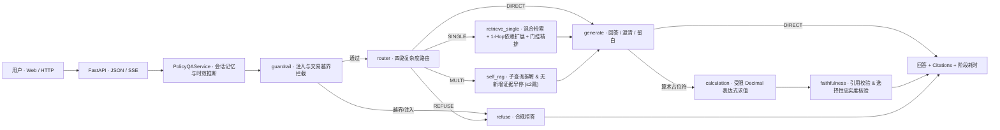

<h1 align="center">Policy-RAG · 电商售后政策问答系统</h1>

<p align="center"><strong>面向电商退换货、运费核算与保修咨询场景的检索增强问答系统，重点解决品类特例与通用总则混淆、过期历史规则误引、跨文档隐式条件漏检及阶梯费用算错问题。</strong></p>

<p align="center">
  FastAPI × LangGraph × Qdrant × BGE + Cross-Encoder (PyTorch / ONNX INT8) × NetworkX 规则依赖图 × 受限 Decimal 计算
</p>

<p align="center">
  <a href="https://github.com/yingjun-huang/policy-RAG/actions/workflows/ci.yml"></a>
  <a href="LICENSE"></a>
  
  
</p>

---

## 界面快照

<p align="center">
  
</p>

<p align="center"><sub>Web 对话台：面对“手机收到好几天了，现在还能退吗？”等前提缺失问题，系统先关联手机激活细则与通用退货总则主动反问澄清，待用户补充条件后给出明确结论并附可核对原文的条款来源</sub></p>

---

## 解决什么问题

把普通知识库问答放进电商售后规则里，常见错答主要集中在五件事：

| 维度 | 常见简单 RAG 的做法 | 本项目的处理 | 代码入口 |
| :--- | :--- | :--- | :--- |
| **切块与表格** | 固定长度滑窗切块，常把前置免责条件与折旧表切碎 | Markdown 标题层级父子分块，超长计价表按行切分并复写表头 | [`chunking.py`](policy_rag/indexing/chunking.py) |
| **版本与时效** | 现行规则与已归档旧规混在同一向量池里召回 | 提取生效区间与品类元数据做检索过滤与生效期校验，对比问题自动解锁历史版本 | [`vector.py`](policy_rag/retrieval/vector.py) · [`filters.py`](policy_rag/retrieval/filters.py) |
| **隐式关联条款** | 仅靠词面 + 向量召回，只问“衣服能退吗”易漏上位总则 | 基于 `config/policy_graph.yaml` + NetworkX 做 1-Hop 规则依赖扩展，经 Cross-Encoder 评分门控精排 | [`clause_graph.py`](policy_rag/retrieval/clause_graph.py) · [`reranker.py`](policy_rag/retrieval/reranker.py) |
| **缺口区分与路由** | 把“用户没说清条件”和“库里没查到规则”混为一谈，盲目强答或死循环补检 | 基于 Pydantic 契约区分事实缺口与证据缺口：分别触发澄清反问或受控多跳补检（最多 2 跳、无增量早停） | [`contracts.py`](policy_rag/agents/contracts.py) · [`graph.py`](policy_rag/agents/graph.py) |
| **费用核算与核验** | 折旧/续重公式交由大模型口算，易出现算术幻觉与无依据承诺 | 引入 AST 解析的受限 `Decimal` 计算器执行占位符表达式，配合风险门控选择性忠实度核验与引用 ID 校验 | [`calculation.py`](policy_rag/calculation.py) · [`nodes.py`](policy_rag/agents/nodes.py) |

---

## 系统架构



一次请求先经过注入与交易越界护栏，再按复杂度分流：问候语直答，单跳与多跳请求执行 `BM25 + BGE + 元数据过滤/生效期校验 -> RRF -> NetworkX 1-Hop 扩展 -> Cross-Encoder 门控精排`；证据充分性评审通过 Pydantic 契约严格区分“缺用户事实（反问澄清）”与“缺政策依据（补检 / 留白）”；生成阶段涉及运费、折旧等算式由受限 `Decimal` 计算器求值回填，后置完成引用 ID 真实性与高风险条款忠实度核验后，由 SSE 先推节点进度再分段发送最终答案。

---

## 快速开始

### 1. 安装环境

需要 **Python 3.11+**。基础依赖与本地向量/精排推理包分开声明：

```bash
git clone https://github.com/yingjun-huang/policy-RAG.git
cd policy-RAG
pip install -e ".[ml,dev]"
cp .env.example .env
```

> Windows PowerShell 可用 `Copy-Item .env.example .env`。仅运行离线单元测试时执行 `pip install -e ".[dev]"` 即可。

在 `.env` 中填入兼容 OpenAI 接口的模型密钥（默认对接 DeepSeek）：

```env
KNOWLEDGE_DIR=knowledge_jd
LLM_API_KEY=your_deepseek_api_key
LLM_BASE_URL=https://api.deepseek.com
LLM_MODEL=deepseek-chat
LOCAL_EMBEDDING_ENABLED=true
CROSS_ENCODER_ENABLED=true
CROSS_ENCODER_USE_ONNX=false
FAITHFULNESS_RISK_GATE_ENABLED=true
```

> `.env` 为空时仍可运行全部离线单元测试；未配置外部 `QDRANT_URL` 时，Qdrant 默认以嵌入式模式在本地运行，无需额外启动容器。

### 2. 启动服务与 Web 界面

```bash
uvicorn policy_rag.api.main:app --host 127.0.0.1 --port 8000
```

打开 **`http://127.0.0.1:8000`** 即可进入对话台；交互式接口文档位于 `/docs`，运行状态自检位于 `/api/v1/capabilities`。

### 3. 接口调用示例

```bash
curl -s http://127.0.0.1:8000/api/v1/capabilities
curl -s http://127.0.0.1:8000/api/v1/chat \
  -H "content-type: application/json" \
  -d '{"message":"已激活的手机还能七天无理由退货吗？","session_id":"demo_01"}'
```

流式接口为 `POST /api/v1/chat/stream`，通过 SSE 先推送 `status` 与各节点处理进度 `node_update`，待生成与后置核验完成后分段发送最终答案 `token` 与完整结果 `done`。

---

## 实测结果

语料库 [`knowledge_jd/`](knowledge_jd) 共 **32 篇**电商售后政策文档（114 个切片，含 2 篇归档历史版本）；评测集 [`eval/dataset/jd_eval_final.jsonl`](eval/dataset/jd_eval_final.jsonl) 包含 **189 个场景、51 个多轮追问（共 240 轮对话）**。默认向量模型为 `BAAI/bge-small-zh-v1.5`，重排模型为 `BAAI/bge-reranker-base`。

### 1. 七路检索与版本隔离消融（175 条标注首问 / 112 条复杂首问）

| 检索方案 | P@1 | Recall@5 | Complete@5 | 复杂问题 Complete@5 | MRR | 版本匹配率 |
| :--- | :---: | :---: | :---: | :---: | :---: | :---: |
| 1. BM25（无版本过滤） | 74.29% | 88.86% | 81.14% | 74.11% | 0.8413 | 78.29% |
| 2. Vector（无版本过滤） | 81.14% | 95.05% | 90.29% | 85.71% | 0.8964 | 73.71% |
| 3. Hybrid RRF（无版本过滤） | 88.00% | 96.00% | 92.00% | 88.39% | 0.9345 | 75.43% |
| 4. Hybrid + 元数据过滤与生效期校验 | 88.57% | 96.00% | 92.00% | 88.39% | 0.9373 | **99.43%** |
| 5. Hybrid + 过滤 + Rerank (ONNX INT8) | **89.71%** | 96.00% | 92.57% | 90.18% | **0.9399** | **99.43%** |
| 6. Hybrid + 规则依赖图 (1-Hop) + Rerank | **89.71%** | 95.81% | 93.14% | 91.07% | 0.9380 | **99.43%** |
| 6b. Hybrid + 规则依赖图 (YAML, CE 门控) + Rerank | **89.71%** | **97.52%** | **95.43%** | **93.75%** | 0.9391 | **99.43%** |

### 2. 在线端到端问答与专项表现（240 轮对话）

- **问答准确率与双模式复核**：Chat 接口生成与三档评分（`correct=1 / partial=0.5 / incorrect=0`）加权正确率 **86.46%**、严格完全正确率 **85.42%**（`205/240`）；切换 Reasoner 接口复核加权正确率 **82.50%**（严格 `78.75%`），两轮三档判定一致率 **91.25%**（`219/240`）。
- **复杂度路由与条件纠偏**：有明确标签首问的策略路由准确率 **82.58%**（`109/132`）；越界办理请求拒答 **100.0%**（`12/12`），用户条件纠偏加权正确率 **95.45%**（`21/22`），主动澄清类场景加权正确率 **92.86%**（`56` 轮）。
- **算术求值专项**：47 条计算目标最终回答正确率 **80.85%**（`38/47`），其中已执行的 `70` 条 `[[calc:...]]` 表达式算术求值全部与规则一致；主要失分集中在少数复杂多条件公式选择与输出格式协议遵循上。

### 本地复现命令

```bash
# 离线单元测试与回归套件（不依赖真实大模型 API）
python -m pytest -q

# 数据资产只读完整性校验
python -m eval.build_dataset --check

# 7 路检索消融与行为评测（支持离线或 --live-llm）
python -m eval.runner --mode all

# 最终 240 轮全量评测 / Reasoner 接口补充复核
python -m scripts.run_closure_final_20261119
python -m scripts.cross_model_judge
```

---

## 目录结构

```text
policy-RAG/
├── config/policy_graph.yaml      # 配置化规则依赖图（继承总则 / 争议举证 / 互补服务）
├── docs/assets/                  # 界面演示截图
├── eval/                         # 评测集、三档评分协议、资产校验与指标计算
├── knowledge_jd/                 # 32 篇电商售后政策语料（含现行与归档历史版本）
├── policy_rag/
│   ├── agents/                   # LangGraph 状态机、路由、Pydantic 契约与核验节点
│   ├── api/                      # FastAPI 路由（/chat, /chat/stream, /capabilities）
│   ├── guardrails/               # 指令注入检测与交易办理类越界拦截
│   ├── indexing/                 # Markdown 父子分块、表格保护与文本清洗
│   ├── providers/                # DeepSeek 客户端、SQLite 缓存、BGE 与 ONNX Cross-Encoder
│   ├── retrieval/                # Qdrant 元数据过滤、BM25、RRF、规则图与门控精排
│   ├── schemas/                  # Pydantic 请求/响应与引用追溯 Schema
│   ├── web/index.html            # 单页对话与条款原文核对界面
│   ├── calculation.py            # AST 受限 Decimal 算术计算器
│   ├── config.py                 # 配置中心
│   └── service.py                # 依赖容器、能力探测与会话编排
├── scripts/                      # 消融、量化、SSE/Embedding 对照与跨模型评分脚本
└── tests/                        # 单元测试与端到端回归测试（375 passed）
```

---

## 使用边界与设计取舍

本项目定位为**电商售后政策知识问答与评测原型**，以下边界属于刻意取舍：

- **短期内存会话而非持久化数据库**：服务端在内存中维护多轮上下文（配合 Web 端 `localStorage`）以支持追问与条件纠偏；未引入 Redis / PostgreSQL 做跨重启长程历史存储。
- **不执行真实业务写操作**：系统识别并拦截“直接退款/修改订单”等交易执行请求，专注政策解释、适用判定与算费核算。
- **本地嵌入式默认运行**：Qdrant 与 BGE/Cross-Encoder 默认支持本地单机运行，降低复现门槛；自建评测集用于功能回归验证，不等同于独立盲测或真实线上流量分布。
