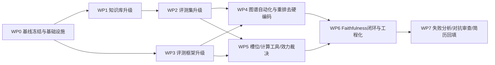

# Policy-RAG V3 升级执行计划（面向 Agent 自动执行）

> 用途：交给执行 Agent 逐个工作包（WP）完成。每个 WP 都写明了目标、输入、产出、步骤、验收命令和禁止事项。
> 计划基于当前仓库实际状态（2026-11-13）编写：32 篇文档 / 114 个 chunk / 145 条评测，在 `all-in-rag` 环境下 51 个测试全部通过。

---

## 0. 总览

### 0.1 为什么要升级（对应上一轮评审的问题）

| 现状问题 | 依据（仓库内） | 本计划对应 WP |
|---|---|---|
| 图谱是手写的：文档级节点，加关键词 cue | `policy_rag/retrieval/clause_graph.py` L20-L243 | WP4 |
| 重排时强制给图扩展结果留名额 | `policy_rag/retrieval/reranker.py` L61-L93 | WP4 |
| 旧评测集被污染：图的边是照着 145 条里的 11 个 bad case 设计的 | `UPGRADE_PLAN.md` 第二节 | WP2（旧集降级为 dev） |
| 生成侧没用真实 LLM 评测，F1 100% 是离线必然结果 | report L126-L127；`eval/runner.py` L476 | WP3 |
| 语料太小、太干净 | `knowledge_jd/` 32 篇，总计约 45KB | WP1 |
| JD 相关的硬编码散落在各处 | `chunking.py` `_DOC_GROUP_PREFIXES`、`filters.py` `resolve_authority_priority`、`validate_assets.py` `VERSION_CHAINS` | WP1、WP4 |
| 澄清不是独立路由，Faithfulness 只跑一次、不是闭环 | `agents/router.py` 只输出 direct/single/multi/refuse；`agents/graph.py` 里 faithfulness 直接连到 END | WP5、WP6 |
| 只测了检索阶段延迟，没有端到端和成本数据 | report L122、L134 | WP3、WP6 |

### 0.2 设计原则
1. **数字只能从报告 JSON 来**：README 和简历里的每个数字，都必须能追溯到 `eval/reports/*.json` 里的某个 key，由脚本渲染，不允许手填。
2. **调参与测试隔离**：所有阈值和超参只能在 `dev` 上调；`test` 只在每个里程碑结束时跑，访问次数有记录。
3. **金标不依赖人工**：计算类金标由 Python 根据 spec 确定性算出；文本类金标靠"生成模型 ≠ 评审模型"的双模型交叉校验，再加程序化校验（引文必须是原文子串、字符位置必须对得上）。
4. **去硬编码**：`policy_rag/` 源码中不得出现具体的 doc_id（由测试强制检查）。
5. **诚实优先**：不给模型指标设硬性目标值，不允许为了凑指标改评测集。效果不显著就如实报告。

### 0.3 人工参与点（只有 4 处，合计约 1 小时）

| # | 时机 | 需要人做什么 | 耗时 |
|---|---|---|---|
| H1 | 开始前 | 在 `.env` 里填 `LLM_API_KEY`（DeepSeek），以及**可选的**第二家评审模型 `JUDGE_*`（通义/智谱/Kimi 等兼容 OpenAI 接口的服务），并设定 token 预算上限 | 5 分钟 |
| H2 | WP1 开始前 | 决定是否抓取真实平台规则页面。默认"否"：只抓官方法律法规原文，平台规则沿用并扩充仿真语料 | 1 分钟 |
| H3 | WP2 结束后（可选，强烈建议） | 抽查 30 条 test 样本（Agent 会生成 `eval/review/spot_check.md`），每条标"对/错" | 30 分钟 |
| H4 | 全部完成后 | 阅读 WP7 审查报告和简历草稿 | 15 分钟 |

### 0.4 里程碑依赖与分工



| 阶段 | 工作包 | 建议 Agent 角色 | 能否并行 | 预估 Agent 工作量 |
|---|---|---|---|---|
| 一 | WP0 | Infra Engineer | — | 0.5 天 |
| 二 | WP1 ∥ WP3 | Corpus Engineer ∥ Eval Infra Engineer | 可以，两者改动的目录不重叠 | 各 2~3 天 |
| 三 | WP2 | Dataset Curator（**只有它能读 test**） | — | 2 天 |
| 四 | WP4 ∥ WP5 | Retrieval Engineer ∥ Agent/Domain Engineer | 可以，各用独立 git 分支 | 各 2~3 天 |
| 五 | WP6 | Infra Engineer | — | 2 天 |
| 六 | WP7 | Reviewer（全新上下文） | — | 1 天 |

> [!TIP]
> 精力有限的话，直接**串行**执行 WP0→WP1→WP3→WP2→WP4→WP5→WP6→WP7，每次只开一个 Agent，最省心。

---

## 1. 全局约束（每个执行 Agent 都必须先读）

### 1.1 环境
- Python 解释器：`C:\Users\admin\anaconda3\envs\all-in-rag\python.exe`（默认的 `python` 缺依赖，不能用）。
- 测试命令：`& C:\Users\admin\anaconda3\envs\all-in-rag\python.exe -m pytest -q`。当前基线为 **51 passed**。任何 WP 结束时测试都必须全部通过，且测试数量只能增加。
- Shell 是 Windows PowerShell，路径用反斜杠，读写文件统一指定 `encoding="utf-8"`。

### 1.2 版本控制与防破坏
- 仓库目前**没有 git**。WP0 第一步执行 `git init` 并提交基线，之后每个 WP 用分支 `wp<N>-<name>` 开发，每完成一个步骤提交一次。
- **禁止**执行 `Remove-Item -Recurse`、`rm -rf`、`del /s` 等批量删除命令。废弃的文件移到 `docs/archive/` 或 `<模块>/legacy/`，并在进度文件中说明。
- 不得修改或删除 `knowledge_jd/`、`eval/dataset/jd_eval_*.jsonl`、`eval/reports/report_2026*.json`，它们是旧基线复现所需的资产。
- 临时脚本放在 `scratch/`（已加入 `.gitignore`），不要在根目录堆文件。

### 1.3 LLM 调用规范
- 所有 LLM 调用必须经过 WP0 实现的 `policy_rag/providers/llm_cache.py`：用 SQLite 缓存，key 为 `sha256(model + messages + temperature + tools)`，并记录 token 用量。
- 任何批量脚本都必须支持 `--limit N` 和 `--dry-run`。**先用 `--limit 5` 跑通，再跑全量。**
- 并发不超过 8（`asyncio.Semaphore`），重试使用 `tenacity`（已在依赖里）。
- 每个脚本结束时打印并写入 `eval/reports/cost_ledger.jsonl`：`{script, model, calls, cache_hits, prompt_tokens, completion_tokens}`。
- 累计 token 超过 `.env` 中的 `LLM_TOKEN_BUDGET` 时立即停止，并在进度文件中报告。

### 1.4 评测纪律（防泄露）
- `eval/dataset/v2/test.jsonl` **只有 Dataset Curator（WP2）和 Reviewer（WP7）可以打开**。其他 Agent 不得读取、grep 或打印其内容。
- `eval/runner.py --split test` 必须同时带 `--final --reason "<说明>"`，每次运行追加一条记录到 `eval/reports/test_access_log.jsonl`。**每个里程碑最多跑 2 次 test**。
- 调参脚本（`eval/tune_*.py`）如果收到的 split 不是 `dev`，直接抛异常。
- `knowledge_v2/_spec/` 是金标真值，**入库、建图、检索代码都不得读取**（WP4 会加一个 grep 测试来强制检查）。

### 1.5 交付规范
- 每个 WP 结束时写 `docs/progress/WP<N>.md`，内容包括：完成项清单、实际执行的命令及关键输出、新增和修改的文件、未完成项和风险、token 消耗。
- 不得在进度文件里写报告 JSON 中不存在的数字。
- 遇到登录墙、验证码、反爬拦截时立即停止该来源，记录下来，然后走回退方案。**不得尝试绕过。**

---

## WP0 基线冻结与基础设施（Infra Engineer，约 0.5 天）

**目标**：给后续所有工作包准备好安全网，包括 git、LLM 缓存与预算控制、数据集划分开关，以及旧基线复现。

**步骤**
1. `git init`。在 `.gitignore` 中追加 `scratch/`、`.cache/`、`knowledge_raw/`、`artifacts/`、`qdrant_storage/`、`.env`。首次提交信息为 `baseline: v1 snapshot`。
2. 把 `PROJECT_PLAN.md`、`UPGRADE_PLAN.md` 移动到 `docs/archive/`（**移动，不删除**），并新建 `docs/progress/`。
3. 新建 `policy_rag/providers/llm_cache.py`：
   - 类 `CachedLLMProvider(inner: LLMProvider, db_path=".cache/llm/cache.sqlite", budget_tokens: int | None)`，包装 `generate()`。命中缓存时直接返回；未命中时调用 inner，然后写入缓存并累加 token。
   - 提供 `usage_snapshot() -> dict` 和 `flush_ledger(script_name)`（追加写入 `eval/reports/cost_ledger.jsonl`）。
   - 在 `policy_rag/service.py` 的 `PolicyContainer` 中装配：新增 `Settings.llm_cache_enabled: bool = True`。
4. 在 `config.py` 中新增配置项：`judge_api_key / judge_base_url / judge_model`、`judge2_api_key / judge2_base_url / judge2_model`、`llm_token_budget: int = 20_000_000`，并同步更新 `.env.example`。
5. 给 `eval/runner.py` 增加参数：
   - `--split {dev,test,legacy}`，默认 `legacy`，即沿用旧数据集路径，以保证旧报告可复现。
   - `--final --reason`，规则见 §1.4 的 test 访问约束。
   - 报告 JSON 增加 `env` 字段：CPU 型号（`platform.processor()`）、是否有 GPU、python 版本、git commit hash、各模型名称。
6. 复现旧基线：执行 `runner.py --split legacy --mode retrieval`，确认 6 路指标与 `report_20261113_082135.json` 一致（允许 ±0.5pp 浮动），然后另存为 `eval/reports/baseline_v1.json`。

**验收**
- `git log --oneline` 至少有 3 次提交；pytest 全部通过，并新增 `tests/test_llm_cache.py`（覆盖命中、未命中、超预算抛异常 3 个用例，使用 FakeLLM）。
- `eval/reports/baseline_v1.json` 已生成，指标与旧报告一致。

---

## WP1 知识库升级（Corpus Engineer，约 2~3 天）

**目标**：把 32 篇约 1KB 的干净文档，扩充为**多层级、多版本、带交叉引用和噪声**的语料。要求：同时有真实法规和仿真平台规则两类来源；元数据全部由 frontmatter 驱动；有一份机器可读的世界设定（spec）作为金标真值。

### 1.1 目标规模（作为验收下限）
| 指标 | 当前 | 目标 |
|---|---|---|
| 文档数 | 32 | **≥ 150** |
| 平均文档长度 | 约 1.4K 字 | **2K~5K 字**（这样父子分块才有意义） |
| chunk 数 | 114 | **≥ 1,200** |
| 版本链（同一主题的新旧版本） | 2 | **≥ 10** |
| 文档类型 | 5 类（按前缀区分） | **≥ 7 类**：law / regulation / platform_general / category / service / shipping / announcement / faq |
| 来源 | 全部仿真 | 真实法规（≥ 6 部）+ 仿真平台规则 |

### 1.2 目录结构
```
knowledge_v2/
  _spec/                  # 金标真值：入库代码禁止读取
    world.yaml            # 平台、商家类型、品类、服务、主题分类体系
    versions.yaml         # 每条版本链：生效区间、适用事件、关键参数
    params.yaml           # 数值参数：运费门槛、偏远加价、折旧率、赔付比例……（按版本区分）
    relations.yaml        # 条款间关系金标：特例→总则、程序依赖、补充、修订
  law/                    # 真实法律法规（经过清洗）
  jd/                     # 迁移过来的 32 篇 + 新增
knowledge_raw/            # 原始 HTML 和 sources.jsonl（不入 git）
```

### 1.3 统一 frontmatter schema（所有文档必须有）
```yaml
---
doc_id: jd_cat_01_mobile_phones        # 全局唯一
title: 手机通讯类商品售后规则
platform: jd                            # jd | law
doc_type: category                      # law|regulation|platform_general|category|service|shipping|announcement|faq
authority_level: 3                      # 1=法律 2=行政法规/部门规章 3=平台规则 4=平台公告 5=FAQ
specificity: 2                          # 1=通用总则 2=品类/专项细则 3=单项服务
topics: [return_7day, quality_return]   # 从 world.yaml 的主题分类体系中选取
categories: [mobile_phones]
merchant_types: [self_operated, pop]
version: 2024-01-v2
effective_from: 2024-01-01
effective_to: null
applicability_event: return_requested_at
provenance: simulated                   # real_law | real_platform | simulated
source_url: null                        # 真实来源必须填
---
```
> [!IMPORTANT]
> frontmatter 中**不允许出现 `references`、`amends` 这类关系字段**。关系必须以自然语言写在正文里（例如"本规则未规定的事项，适用《通用退货规则》"），或者完全隐含不写。WP4 需要从正文中**自动抽取**这些关系，`_spec/relations.yaml` 只用于评估抽取质量。

### 1.4 步骤
1. **迁移旧语料**：把 32 篇复制到 `knowledge_v2/jd/`（原目录保持不动）。frontmatter 由 Agent 根据文件名前缀和版本行自动生成，**正文不改**。版本行 `政策版本：… | 生效期：… | 适用事件：…` 保留，`chunking.py` 仍然能解析。
2. **编写 `_spec/`**（由 LLM 起草，再程序校验）：
   - 先从现有 32 篇中**抽取**已有的参数和关系，写入 `params.yaml` 与 `relations.yaml`，保证新旧一致。例如七天起算口径、99 元免运费门槛（旧版）。
   - 再扩展出新的品类（≥ 10 个，如二手、医药保健、图书、汽车用品、宠物生活、生鲜冷冻、大件家具安装、手机以旧换新、数字内容、充值卡）、新的服务（≥ 5 个）和新的版本链（≥ 8 条，覆盖跨年的门槛和比例调整）。
   - 用 `eval/validate_spec.py` 做结构校验：主题必须来自分类体系；同一版本链的生效区间首尾相接，不重叠也不留空档；参数类型和单位必须合法。
3. **抓取真实法规**（只用官方来源，如中国政府网、国家法律法规数据库、市场监管总局官网）：
   - 必选：《消费者权益保护法》《消费者权益保护法实施条例》《电子商务法》《网络购买商品七日无理由退货暂行办法》《网络交易监督管理办法》《产品质量法》；能找到的话再加《部分商品修理更换退货责任规定》（三包规定）。
   - 抓取方式：`httpx` 获取 HTML，`trafilatura` 或 `markdownify` 转成 Markdown，再用规则把"第X章/第X条"转为 H2/H3。生效日期和修订历史**必须从原文中提取**，提取后写进 frontmatter，并校验该日期字符串在原文中确实出现。
   - 这些文本属于《著作权法》第五条规定的不适用范围（法律、法规等），可以放进仓库。
   - 遇到拦截就跳过该来源并记录。最终 law 类文档不足 4 部时，在进度文件里报告，**不要编造法条**。
4. **（H2 选"是"才执行）抓取真实平台规则**：只抓无需登录的公开规则页，遇到验证码立即停止。原文放 `knowledge_raw/`（不入 git），转换后的版本标记 `provenance: real_platform`。
5. **生成仿真平台文档**（`scripts/corpus/generate_docs.py`）：
   - 输入为 `_spec/` 中的某个条目；LLM 按"H1 标题 → 版本行 → H2 条款"的固定模板写作，每篇 2K~5K 字。
   - 写作约束（写进 prompt）：数值只能来自 `params.yaml`；被 `relations.yaml` 标为 `explicit` 的关系必须在正文中用《标题》显式引用，标为 `implicit` 的**不得**显式引用；至少包含 1 张 Markdown 表格。
   - 写入以下几类**真实世界常见的噪声文档**：
     - `announcement`：例如"关于调整偏远地区运费的公告"，只修订原规则中的某一条，自某日起生效。这类**部分修订**是检索的难点。
     - `faq`：用口语化方式复述规则，其中约 20% 故意基于旧版本（标 `effective_to`），用作过期干扰项。
     - 近似重复文档：同一主题、不同商家类型（自营 / POP）的规则，内容高度相似但个别参数不同。
6. **校验器升级**（`eval/validate_assets.py` 改为按 namespace 分别校验，旧逻辑保留在 `jd_legacy` 模式下）：
   - **数值一致性**：从正文中抽出所有数字和金额，凡是对应 `params.yaml` 中键的必须完全一致（每个参数在 spec 中登记 `surface_patterns` 用于匹配）。
   - **关系一致性**：`explicit` 关系的目标标题必须出现在源文档正文里；`implicit` 关系的目标标题不得出现。
   - **结构**：只有 1 个 H1，有版本行，frontmatter 字段齐全，`topics` 合法。
   - `_FORBIDDEN_BODY_PAT` 只作用于 `provenance: simulated` 的文档，因为法规原文里本来就有"国家标准"等词。
   - 校验失败的文档由脚本自动回炉重写（最多 2 次），仍然失败就移到 `knowledge_v2/_rejected/` 并记录。
7. **去掉代码中的 JD 硬编码**：
   - `chunking.py`：`doc_group` 和权威层级优先从 frontmatter 的 `doc_type / authority_level / specificity` 读取，前缀推断只作为 legacy 回退。
   - `filters.py`：`resolve_authority_priority` 改为基于 `authority_level` 和 `specificity` 两个维度，不再判断前缀。
   - `Settings.knowledge_dir` 支持指向 `knowledge_v2`，并递归扫描子目录（跳过 `_spec`、`_rejected`）。
8. 用 `knowledge_v2` 构建一次索引，确认 Qdrant 中 payload 字段齐全，并输出语料统计到 `docs/progress/WP1_corpus_stats.json`（按 doc_type、provenance、topic 计数，以及 chunk 长度分布）。

**验收**
- 达到 §1.1 中的全部规模下限；`validate_assets.py --namespace all` 零错误；`validate_spec.py` 零错误。
- 新增 `tests/test_frontmatter_metadata.py`，验证 authority 解析、递归扫描时跳过 `_spec`。
- 在 `knowledge_jd` 上跑旧评测，结果与 `baseline_v1.json` 一致（证明重构没有改变旧行为）。

**禁止**：编造法条或来源 URL；在 frontmatter 中写关系字段；让入库代码读取 `_spec/`。

---

## WP2 评测集升级（Dataset Curator，约 2 天）

**目标**：旧的 145 条全部降级为 `dev`（它们已被用来调参，属于污染数据）；新生成一份 **≥ 400 条的冻结 test 集**。金标靠程序校验加双模型交叉校验产生，不需要人工标注。

**test 配额**：single_hop 60 / multi_hop_explicit 50 / implicit_inheritance 50 / table_lookup 40 / calculation 50 / version_temporal（含公告部分修订）50 / law_hierarchy 30 / clarification（多轮）30 / abstain 25 / refuse 15。
**问法风格**：口语 40%、错别字或缩写 20%、带干扰信息的长叙述 20%、标准问法 20%。

**步骤**（脚本放在 `eval/gen/`）
1. `generate_cases.py`：
   - 从 `_spec/relations.yaml` 和语料中采样证据条款（**禁止使用 WP4 的建图结果来采样**），由 LLM 写问题、金标答案，以及金标引文（必须是原文原句）。
   - calculation 类：Python 先按 `params.yaml` 随机生成订单参数，再确定性地算出答案，LLM 只负责把它写成自然的问题。
   - clarification 类：从一个完整问题中删掉某个关键槽位，得到 `expected_action=clarify`；再追加一轮补充该槽位的追问，作为 follow-up turn。
2. `filters.py`：每条候选样本依次通过以下过滤，任一不通过即丢弃：
   - (a) 引文是原文的精确子串，并计算出字符位置 char_start/char_end；
   - (b) 与证据的字面重合度低于阈值，避免题目直接照抄关键词；
   - (c) 与已有样本的 embedding 相似度低于 0.92（去重）；
   - (d) 评审模型 A **只看金标证据**就能答对；
   - (e) multi-hop 类：**去掉任意一份证据后**，评审模型 A 必须答不对，以证明每份证据都是必需的；
   - (f) 评审模型 B（与生成模型不同家族）独立判定这条样本有效。A、B 意见不一致就丢弃。
3. `perturb.py`：对通过的样本做风格扰动，扰动后重新执行 2(d) 的校验。
4. `split.py`：按 `scenario_group` 分层切分，同一场景只能出现在一个 split 里；生成 `v2/test.jsonl` 和 `v2/test.sha256`；dev = 旧 145 条 + 新生成的约 150 条。
5. 生成 `eval/review/spot_check.md`：随机抽 30 条 test 样本，供人工检查点 H3 使用；同时报告评审模型 A 与 B 的一致率（Cohen's κ）。

**验收**：test ≥ 400 且各类别满足配额；引文校验 100% 通过；生成报告 `eval/reports/dataset_v2_stats.json`，内容包括各阶段过滤掉的数量和 κ 值。

---

## WP3 评测框架升级（Eval Infra Engineer，约 2 天；可与 WP1 并行）

1. **片段级检索指标**：在 chunk 的 metadata 中补上原文字符区间（以原始文件文本为坐标系）。如果检索到的 chunk 与金标引文的字符区间重叠 ≥ 50%，记为命中。据此计算 EvidenceRecall@k、EvidenceComplete@k、nDCG@10，**文档级指标保留**以便对比。
2. **统计显著性**：新建 `eval/stats.py`，用 1000 次重采样做配对 bootstrap，输出 Δ 值和 95% 置信区间，以及两组方案之间"多对的样本数 / 多错的样本数"。
3. **生成侧评测**（真实 LLM）：新建 `eval/judges/`，包含：
   - 答案正确性：三档（对 / 部分对 / 错）；数值类答案用程序解析后直接比对；
   - claim 级忠实度：把答案拆成若干 claim，逐条判断能否被引用的证据支持，得到幻觉率；
   - 引用精确率 / 召回率；
   - 动作混淆矩阵：answer / clarify / abstain / refuse 四类；
   - 路由准确率：金标由类别映射得到。
4. **成本与延迟**：按路由分别统计端到端 P50/P95、TTFT、平均 LLM 调用次数、token 数和单次成本。测延迟前先预热；报告中记录运行环境。
5. **报告渲染**：新建 `scripts/render_results.py`，把报告 JSON 渲染成 `docs/RESULTS.md`。README 和简历里的数字只从这里取。

**验收**：在 dev 上跑通 `--mode all --live-llm`；新增测试覆盖指标函数和 bootstrap 计算。

---

## WP4 图谱自动化与重排去硬编码（Retrieval Engineer，约 2~3 天）

1. 新建 `policy_rag/graph/`。**节点粒度改为条款级**：节点就是父 section，`clause_id = doc_id#section`。
2. **自动抽边**，分四种：
   - `EXPLICIT_REF`：正则匹配《标题》和"第X条"等引用，再模糊匹配到具体文档或条款；
   - `AMENDS`：从公告类文档的正文中抽取（规则匹配加 LLM 判断）；
   - `SCOPE_INHERIT`：根据元数据推断，同一平台、同一主题下，specificity=2 的细则指向 specificity=1 的总则；
   - `LLM_RELATION`：候选对为主题有重叠的跨文档条款对，每个节点取 top10，由 LLM 分类并给出引文依据，结果走缓存。
   - 每条边都记录来源依据。建图结果保存为 `artifacts/graph/clause_graph.json`，入口为 `python -m policy_rag.graph.build`。
3. **评估边质量**：在仿真语料上，与 `_spec/relations.yaml` 对比，按边类型计算 P/R/F1；在法规语料上，抽样后由双模型评审判断。
4. **扩展与重排**：
   - 删除关键词 cue 和强制留名额的逻辑。旧实现移到 `retrieval/legacy/`，作为一组对照方案保留在消融实验里。
   - 新方案：图扩展得到的候选和直接召回的候选一起送进 Cross-Encoder 打分，最终分 `s = ce + λ·w_edge`。λ、种子数、最大扩展数这几个参数由 `eval/tune_graph.py` **只在 dev 上**网格搜索确定，并输出参数与指标的关系曲线。
5. 新增测试 `tests/test_no_hardcode.py`：用 grep 检查 `policy_rag/` 下的源码中不得出现 `jd_cat_`、`jd_rule_` 等 doc_id 字面量，也不得出现 `_spec` 路径。

**验收**：边 F1 报告；dev 上的消融实验覆盖 无图 / 旧图 / 新图 三组；test 只运行 1 次，结果带置信区间。**效果不显著也必须如实写。**

---

## WP5 领域能力（Agent/Domain Engineer，约 2~3 天；可与 WP4 并行）

1. **槽位抽取节点**：新建 `schemas/slots.py`，字段包括品类、签收日期、是否激活、订单金额、重量、地区、会员、问题类型、支付时间等。用 function calling 抽取，多轮对话中累积合并。用 dev 和 test 中已有的 `known_slots` 作为金标，计算槽位 F1。
2. **计算工具**：新建 `policy_rag/tools/`，包含 date_window（按 Asia/Shanghai 时区、"签收次日 0 点起算"的口径）、freight、price_protection、compensation 四个工具。**工具参数在入库时由 LLM 从规则表格中抽取**，生成 `artifacts/params/*.json`，并带上出处 chunk_id。工具的计算结果作为证据参与引用。在 calculation 类上做 有工具 / 无工具 的对比。
3. **效力裁决**：按"层级 × 特别性 × 时效"三个维度给每条证据打标签，并处理"平台规则不得低于法定保底"的冲突。在 law_hierarchy 和 implicit_inheritance 两类上做开 / 关的消融。
4. **澄清**：把"缺失的关键槽位"显式传给生成节点；单独报告澄清的 P/R。**简历里不再写"五路路由"**。

---

## WP6 Faithfulness 闭环与工程化（Infra Engineer，约 2 天）

1. **Faithfulness**：改为 claim 级校验，校验不通过就重新生成，最多重试 1 次。报告以下指标：触发率、纠正前后的幻觉率、误纠率（原本正确的答案被改坏的比例），以及额外增加的延迟和成本。
2. **性能**：
   - 重排的候选数分别取 10 / 20 / 30，画出效果与延迟的曲线；
   - self_rag 中的子查询改为 `asyncio.gather` 并行执行；
   - 可选：ONNX int8 量化。
   - 新建 `scripts/loadtest.py`，在并发 1 / 4 / 8 / 16 下测 QPS 和 P95：用固定延迟的假 LLM 测系统本身的开销，再用小批量真实 LLM 测一次。
3. **增量索引**：新建 `indexing/sync.py`，以文档 sha256 为准做 diff，只对变化的文档执行 Qdrant 的增量写入和删除，并局部重建受影响的图节点。
4. **回归门禁**：新建 `eval/gate.py`，在 dev 上与基线比较，任一指标下降超过 1pp 即判失败；新建 `.github/workflows/ci.yml`，执行 pytest、语料校验和离线小规模检索评测。

---

## WP7 失败分析、对抗审查与简历回填（Reviewer，全新上下文，约 1 天）

1. 新建 `eval/analyze_failures.py`：利用请求链路的中间结果，把失败样本自动归因为 召回漏检 / 元数据过滤误杀 / 重排截断 / 图扩展缺失 / 生成错误 / 澄清误判 几类，输出每类的数量和典型例子，写入 `docs/BAD_CASES.md`。
2. 对抗审查，逐项核对：
   - 简历里的每个数字都能追溯到报告 JSON 中的某个 key；
   - `test_access_log` 中的 test 运行次数没有超过限制；
   - 调参脚本没有读取 test；
   - 源码中没有硬编码的 doc_id。
   - 审查结果写入 `docs/AUDIT.md`。
3. 用 `docs/RESULTS.md` 中的数字回填下面的目标简历。

---

## 附录 A：目标简历（`[ ]` 中的内容由 WP7 根据报告填写）

> **电商售后政策智能问答系统｜Graph-Enhanced Adaptive RAG**
> 技术栈：Python、FastAPI、LangGraph、DeepSeek、BGE、BM25、Cross-Encoder、Qdrant、NetworkX、SSE
>
> - **背景**：售后咨询里常见三类错误：品类特例与通用总则混用、规则修订后误引旧条款、运费和时效算错。针对这些问题，在 [N] 篇文档、[M] 个切片的语料上构建 RAG 问答。语料包括 6 部消费者权益相关法规，以及带版本链和修订公告的平台规则。
> - **结构化索引与时效控制**（WP1）：基于 frontmatter 的元数据做父子分块，表格按行切分并重复表头；Qdrant 按生效区间、适用事件和平台做前置过滤；公告类文档的部分修订按条款级覆盖处理。归档规则的误召回率从 [a]% 降到 [b]%。
> - **条款依赖图自动构建**（WP4）：在 [n] 个条款节点上，通过显式引用解析、元数据继承推断和 LLM 关系分类三种方式自动抽边，边抽取 F1 为 [x]%。1-Hop 补全的结果与直接召回结果一起参与 Cross-Encoder 打分融合，参数只在 dev 集上调。在 [400+] 条冻结 test 集上，片段级 EvidenceComplete@5 从 [a]% 提升到 [b]%（95% CI [..]），隐式继承类问题从 [c]% 提升到 [d]%。
> - **领域推理**（WP5）：通过槽位抽取（F1 [x]%）驱动澄清追问；时效、运费、价保的计算交给工具完成，工具参数从规则表格中自动抽取并可溯源，计算类问题正确率从 [a]% 提升到 [b]%；证据按"法规层级 × 特别性 × 时效"三个维度做效力裁决。
> - **评测与工程**（WP2/3/6）：用双模型交叉校验和程序化校验构建评测集，评审一致性 κ=[x]；claim 级 Faithfulness 校验使幻觉率从 [a]% 降到 [b]%（额外延迟 +[t]s）；按路由统计端到端 P95 [x]s、TTFT [y]s、单次成本 [z]；支持增量索引和 CI 回归门禁。

---

## 附录 B：交给 Agent 的启动指令模板

```text
你是 <角色>。工作目录 d:\PythonProject\Application\policy-rag。
1. 先完整阅读 docs/UPGRADE_PLAN_V3.md 中的「§1 全局约束」和「WP<N>」，严格按其中的步骤执行。
2. 动手之前先检查相关文件的现状；每完成一个步骤执行一次 pytest，并做一次 git 提交（分支 wp<N>-<name>）。
3. 任何批量 LLM 调用都必须先用 --limit 5 跑通；遇到验证码或登录墙立即停止，记录后走回退方案。
4. 结束时写 docs/progress/WP<N>.md，内容包括：完成项、执行过的命令及关键输出、未完成项、token 消耗。
   不得写出报告 JSON 中不存在的数字。
5. 遇到计划没有覆盖的设计决策，选最简单、可验证的方案，并在进度文件中说明理由。
```
执行顺序（串行最省心）：WP0 → WP1 → WP3 → WP2 → WP4 → WP5 → WP6 → WP7。
